import { Terminology } from '@cbnventures/docusaurus-preset-nova/blocks';
import Tabs from '@theme/Tabs';
import TabItem from '@theme/TabItem';

The **Nova <Terminology title="command line interface" to="/docs/quickstart/terminology#fundamentals" color={true}>CLI</Terminology>** lets you generate files, apply local assets through vendor integrations, run <Terminology title="transform script" to="/docs/quickstart/terminology#nova-concepts" color={true}>recipes</Terminology>, <Terminology title="project starter" to="/docs/quickstart/terminology#nova-concepts" color={true}>scaffold</Terminology> projects, and use development utilities.

:::tip Step by step
Not sure what to type? Build the command **one section at a time**.

Start with `nova`, then the **command** and **subcommand** (if available), and finally the **options** like `--all` or `-a`. Each step shows **inline guidance** so you don't wonder what to do next.
:::

## Get Started

<Tabs groupId="install-state">
  <TabItem value="nova" label="nova (installed)" default>

    ```bash
    nova <command> <subcommand> [option]
    ```

  </TabItem>
  <TabItem value="npx" label="npx (no install)">

    ```bash
    npx --yes @cbnventures/nova@latest <command> <subcommand> [option]
    ```

  </TabItem>
</Tabs>

- **Options are recommended** — Type the option (**flags / switches**) you want, like `--all` or `-a`. This helps you learn the command faster.
- **Build it step by step** — Start with `nova`, add the **command** and **subcommand**, then finish with **options** like `--all` or `-a`. Repeat until it feels natural.

## Commands

```mermaid
flowchart TD
    CLI[nova] --> GEN[generate]
    CLI --> INT[integration]
    CLI --> RCP[recipe]
    CLI --> SCAF[scaffold]
    CLI --> UTIL[utility]

    subgraph Generators
        direction LR
        GEN --> GH[github] --> GH1[funding / issue-template / workflows]
        GEN --> MUST[must-haves] --> MUST1[agent-conventions / dotenv / editorconfig / ...]
    end

    subgraph Integrations
        direction LR
        INT --> ASC[app-store-connect] --> ASC1[creative-assets / metadata / screenshots]
        INT --> DDP[discord-developer-portal] --> DDP1[validate-token]
        INT --> GPC[google-play-console] --> GPC1[graphic-assets / metadata / screenshots]
    end

    subgraph Recipes
        direction LR
        RCP --> GHR[github] --> GHR1[sync-features / sync-identity / sync-policies]
        RCP --> PKG[package-json] --> PKG1[cleanup / normalize-* / sync-*]
        RCP --> MISC[miscellaneous] --> MISC1[fix-markdown-tables / remove-operating-system-files]
    end

    subgraph Scaffolding
        direction LR
        SCAF --> APP[app] --> APP1[android / apple / astro / discord-bot / expressjs / nextjs / vite]
        SCAF --> DOCS[docs] --> DOCS1[docusaurus]
        SCAF --> PACKAGE[package] --> PACKAGE1[github-action / homebridge / pfsense]
        SCAF --> START[starter] --> START1[base]
        SCAF --> TOOL[tool] --> TOOL1[serverless]
    end

    subgraph Utilities
        direction LR
        UTIL --> UTIL1[changelog / configure / run-recipes / run-scripts / run-workspaces / ...]
    end
```



All commands below **show a help screen when run with the `--help` or `-h` option**, so you can explore safely and avoid accidental runs.

:::tip Mix and match
You can freely combine full names and shorthands in the same command. For example, `nova generate must lic` and `nova gen must-haves license` both work the same way.
:::

### Generators

Create **semi-tailored** vendor and project files at the <Terminology title="project root" to="/docs/quickstart/terminology#git-and-workflow" color={true}>monorepo root</Terminology>. Generators read <Terminology title="Nova config" to="/docs/quickstart/terminology#nova-concepts" color={true}>`nova.config.json`</Terminology> when their output needs project-level values.

:::info
Generators use `nova generate <category> <subcommand>`.
:::

#### GitHub
_Category: `github` · Alias: `gh`_

| Subcommand                                                     | Shorthand | What It Does                                                                                                                                                                                                                    |
|----------------------------------------------------------------|-----------|---------------------------------------------------------------------------------------------------------------------------------------------------------------------------------------------------------------------------------|
| [`funding`](/docs/cli/generators/github/funding)               | —         | Create a `.github/FUNDING.yml` file for [GitHub](https://github.com/) sponsor links.                                                                                                                                            |
| [`issue-template`](/docs/cli/generators/github/issue-template) | `issue`   | Create `.github/ISSUE_TEMPLATE` files for [GitHub](https://github.com/) issue forms.                                                                                                                                            |
| [`workflows`](/docs/cli/generators/github/workflows)           | —         | Create `.github/workflows` files for [GitHub](https://github.com/) <Terminology title="continuous integration and deployment" to="/docs/quickstart/terminology#builds-and-tooling" color={true}>CI/CD</Terminology> automation. |

#### Must-Haves
_Category: `must-haves` · Alias: `must`_

| Subcommand                                                               | Shorthand | What It Does                                                   |
|--------------------------------------------------------------------------|-----------|----------------------------------------------------------------|
| [`agent-conventions`](/docs/cli/generators/must-haves/agent-conventions) | `agent`   | Create agent convention files for coding assistants.           |
| [`dotenv`](/docs/cli/generators/must-haves/dotenv)                       | `env`     | Create `.env` and `.env.sample` files for environment secrets. |
| [`editorconfig`](/docs/cli/generators/must-haves/editorconfig)           | —         | Create a `.editorconfig` file for consistent coding styles.    |
| [`ignore-files`](/docs/cli/generators/must-haves/ignore-files)           | —         | Create every configured physical ignore file.                  |
| [`license`](/docs/cli/generators/must-haves/license)                     | `lic`     | Create a `LICENSE` file for project license agreements.        |
| [`read-me`](/docs/cli/generators/must-haves/read-me)                     | `read`    | Create a baseline `README.md` file for your project.           |

### Integrations

Apply local project assets through supported vendor services without storing credentials in `nova.config.json`. Running `nova integration` or a vendor category opens an interactive menu; leaf commands remain directly scriptable.

:::info
Integration commands use `nova integration <vendor> <operation>` or `nova int <alias> <operation>`.

Mutating commands print their complete plan before authentication. Use `-d, --dry-run` to validate without authenticating or changing remote data. Non-interactive mutations require `-n, --non-interactive` together with `-y, --yes`.
:::

#### App Store Connect
_Category: `app-store-connect` · Alias: `asc`_

| Subcommand                                                                    | Shorthand | What It Does                                                        |
|-------------------------------------------------------------------------------|-----------|---------------------------------------------------------------------|
| [`creative-assets`](/docs/cli/integrations/app-store-connect/creative-assets) | —         | Replace selected App Store promotional artwork.                     |
| [`metadata`](/docs/cli/integrations/app-store-connect/metadata)               | —         | Update selected localized App Store version metadata.               |
| [`screenshots`](/docs/cli/integrations/app-store-connect/screenshots)         | —         | Replace selected iPhone, iPad, Apple Watch, or Mac screenshot sets. |

#### Discord Developer Portal
_Category: `discord-developer-portal` · Alias: `ddp`_

| Subcommand                                                                         | Shorthand | What It Does                                                 |
|------------------------------------------------------------------------------------|-----------|--------------------------------------------------------------|
| [`validate-token`](/docs/cli/integrations/discord-developer-portal/validate-token) | —         | Validate a Discord bot token without storing or printing it. |

#### Google Play Console
_Category: `google-play-console` · Alias: `gpc`_

| Subcommand                                                                    | Shorthand | What It Does                                          |
|-------------------------------------------------------------------------------|-----------|-------------------------------------------------------|
| [`graphic-assets`](/docs/cli/integrations/google-play-console/graphic-assets) | —         | Replace selected Google Play graphic asset sets.      |
| [`metadata`](/docs/cli/integrations/google-play-console/metadata)             | —         | Update selected localized Google Play listing fields. |
| [`screenshots`](/docs/cli/integrations/google-play-console/screenshots)       | —         | Replace selected Google Play screenshot sets.         |

### Recipes

Apply **scripted edits** that automate routine maintenance, using values from <Terminology title="Nova config" to="/docs/quickstart/terminology#nova-concepts" color={true}>`nova.config.json`</Terminology> when the recipe needs configured project data.

:::info
All commands in "Recipes" are shaped as `nova recipe <category> <subcommand>` or `nova rcp <alias> <shorthand>`.

Recipe categories are navigation menus, not batch commands. Use [`nova utility run-recipes`](/docs/cli/utilities/run-recipes) when you want Nova to run every enabled recipe.
:::

#### GitHub
_Category: `github` · Alias: `gh`_

| Subcommand                                                | Shorthand   | What It Does                                                                                            |
|-----------------------------------------------------------|-------------|---------------------------------------------------------------------------------------------------------|
| [`sync-actions`](/docs/cli/recipes/github/sync-actions)   | `sync-act`  | Sync GitHub Actions permissions, token defaults, and artifact retention.                                |
| [`sync-features`](/docs/cli/recipes/github/sync-features) | `sync-feat` | Sync repository feature flags (issues, wiki, projects, discussions) to [GitHub](https://github.com/).   |
| [`sync-identity`](/docs/cli/recipes/github/sync-identity) | `sync-id`   | Sync repository identity (description, homepage URL, topics) to [GitHub](https://github.com/).          |
| [`sync-labels`](/docs/cli/recipes/github/sync-labels)     | `sync-lab`  | Create or update configured GitHub repository labels.                                                   |
| [`sync-policies`](/docs/cli/recipes/github/sync-policies) | `sync-pol`  | Sync repository policies (visibility, merge methods, branch settings) to [GitHub](https://github.com/). |
| [`sync-rulesets`](/docs/cli/recipes/github/sync-rulesets) | `sync-rule` | Create or update Nova's managed default-branch ruleset.                                                 |
| [`sync-security`](/docs/cli/recipes/github/sync-security) | `sync-sec`  | Sync vulnerability, Dependabot, secret scanning, and push protection settings.                          |

#### License
_Category: `license` · Alias: `lic`_

| Subcommand                                                       | Shorthand     | What It Does                                                   |
|------------------------------------------------------------------|---------------|----------------------------------------------------------------|
| [`update-copyright`](/docs/cli/recipes/license/update-copyright) | `update-copy` | Refresh the generated license copyright holder and year range. |

#### Miscellaneous
_Category: `miscellaneous` · Alias: `misc`_

| Subcommand                                                                                       | Shorthand         | What It Does                                                                                |
|--------------------------------------------------------------------------------------------------|-------------------|---------------------------------------------------------------------------------------------|
| [`fix-markdown-tables`](/docs/cli/recipes/miscellaneous/fix-markdown-tables)                     | `fix-md-tables`   | Format Markdown and MDX tables throughout the project root.                                 |
| [`remove-operating-system-files`](/docs/cli/recipes/miscellaneous/remove-operating-system-files) | `remove-os-files` | Remove explicitly enabled, untracked operating-system metadata files from the project root. |

#### nova.config.json
_Category: `nova-config` · Alias: `config`_

| Subcommand                                                         | Shorthand    | What It Does                                                                       |
|--------------------------------------------------------------------|--------------|------------------------------------------------------------------------------------|
| [`normalize-order`](/docs/cli/recipes/nova-config/normalize-order) | `norm-order` | Normalize top-level `nova.config.json` key order without changing configured data. |

#### package.json
_Category: `package-json` · Alias: `pkg`_

| Subcommand                                                                        | Shorthand   | What It Does                                                                                           |
|-----------------------------------------------------------------------------------|-------------|--------------------------------------------------------------------------------------------------------|
| [`cleanup`](/docs/cli/recipes/package-json/cleanup)                               | `clean`     | Remove unsupported keys and reorder remaining keys in workspace `package.json` files.                  |
| [`normalize-artifacts`](/docs/cli/recipes/package-json/normalize-artifacts)       | `norm-art`  | Normalize files, bin, man, directories, private, and publishConfig in workspace `package.json` files.  |
| [`normalize-bundler`](/docs/cli/recipes/package-json/normalize-bundler)           | `norm-bun`  | Normalize types, module, sideEffects, and esnext bundler fields in workspace `package.json` files.     |
| [`normalize-dependencies`](/docs/cli/recipes/package-json/normalize-dependencies) | `norm-dep`  | Normalize dependency fields and optionally pin versions in workspace `package.json` files.             |
| [`normalize-modules`](/docs/cli/recipes/package-json/normalize-modules)           | `norm-mod`  | Normalize exports, main, type, browser, and imports fields in workspace `package.json` files.          |
| [`normalize-tooling`](/docs/cli/recipes/package-json/normalize-tooling)           | `norm-tool` | Normalize scripts, gypfile, config, and workspaces in workspace `package.json` files.                  |
| [`sync-environment`](/docs/cli/recipes/package-json/sync-environment)             | `sync-env`  | Sync engines, os, cpu, libc, devEngines, and packageManager in workspace `package.json` files.         |
| [`sync-identity`](/docs/cli/recipes/package-json/sync-identity)                   | `sync-id`   | Sync name, version, description, keywords, displayName, and license to workspace `package.json` files. |
| [`sync-ownership`](/docs/cli/recipes/package-json/sync-ownership)                 | `sync-own`  | Sync homepage, bugs, author, contributors, funding, and repository to workspace `package.json` files.  |

#### README
_Category: `read-me` · Alias: `read`_

| Subcommand                                                               | Shorthand       | What It Does                                       |
|--------------------------------------------------------------------------|-----------------|----------------------------------------------------|
| [`update-badges`](/docs/cli/recipes/read-me/update-badges)               | `update-badge`  | Refresh the generated README badge region.         |
| [`update-credits`](/docs/cli/recipes/read-me/update-credits)             | `update-credit` | Refresh the generated README credits region.       |
| [`update-documentation`](/docs/cli/recipes/read-me/update-documentation) | `update-doc`    | Refresh the generated README documentation region. |
| [`update-header`](/docs/cli/recipes/read-me/update-header)               | `update-head`   | Refresh the generated README header region.        |
| [`update-introduction`](/docs/cli/recipes/read-me/update-introduction)   | `update-intro`  | Refresh the generated README introduction region.  |

### Scaffolding

Bootstrap **full project starters** as <Terminology title="multi-package repo" to="/docs/quickstart/terminology#git-and-workflow" color={true}>monorepo</Terminology> workspaces. Each <Terminology title="project starter" to="/docs/quickstart/terminology#nova-concepts" color={true}>scaffold</Terminology> creates a ready-to-use workspace with all necessary config files, dependencies, and build setup.

:::info
All commands in "Scaffolding" are shaped as `nova scaffold <category> <subcommand>` or `nova scaf <alias> <shorthand>`.
:::

#### App
_Category: `app` · Alias: none_

| Subcommand                                             | Shorthand | What It Does                         |
|--------------------------------------------------------|-----------|--------------------------------------|
| [`android`](/docs/cli/scaffolding/app/android)         | —         | Scaffold a native Android workspace. |
| [`apple`](/docs/cli/scaffolding/app/apple)             | —         | Scaffold a SwiftUI Apple workspace.  |
| [`astro`](/docs/cli/scaffolding/app/astro)             | —         | Scaffold an Astro workspace.         |
| [`discord-bot`](/docs/cli/scaffolding/app/discord-bot) | —         | Scaffold a Discord bot workspace.    |
| [`expressjs`](/docs/cli/scaffolding/app/expressjs)     | `express` | Scaffold an Express.js workspace.    |
| [`nextjs`](/docs/cli/scaffolding/app/nextjs)           | `next`    | Scaffold a Next.js workspace.        |
| [`vite`](/docs/cli/scaffolding/app/vite)               | —         | Scaffold a Vite workspace.           |

#### Docs
_Category: `docs` · Alias: none_

| Subcommand                                            | Shorthand | What It Does                                   |
|-------------------------------------------------------|-----------|------------------------------------------------|
| [`docusaurus`](/docs/cli/scaffolding/docs/docusaurus) | —         | Scaffold a Docusaurus documentation workspace. |

#### Package
_Category: `package` · Alias: `pkg`_

| Subcommand                                                     | Shorthand | What It Does                                   |
|----------------------------------------------------------------|-----------|------------------------------------------------|
| [`github-action`](/docs/cli/scaffolding/package/github-action) | `action`  | Scaffold a bundled GitHub Action package.      |
| [`homebridge`](/docs/cli/scaffolding/package/homebridge)       | —         | Scaffold a dynamic-platform Homebridge plugin. |
| [`pfsense`](/docs/cli/scaffolding/package/pfsense)             | —         | Scaffold a WebGUI-managed pfSense package.     |

#### Starter
_Category: `starter` · Alias: `start`_

| Subcommand                                   | Shorthand | What It Does                                                    |
|----------------------------------------------|-----------|-----------------------------------------------------------------|
| [`base`](/docs/cli/scaffolding/starter/base) | —         | Scaffold a base monorepo project without a framework workspace. |

#### Tool
_Category: `tool` · Alias: none_

| Subcommand                                            | Shorthand | What It Does                                                          |
|-------------------------------------------------------|-----------|-----------------------------------------------------------------------|
| [`serverless`](/docs/cli/scaffolding/tool/serverless) | —         | Scaffold a distributable CLI with a user-deployed serverless service. |

### Utilities

Tools for **diagnostics**, **quick checks**, and **development helpers**.

:::info
All commands in "Utilities" are shaped as `nova utility <subcommand>` or `nova util <shorthand>`.
:::

| Subcommand                                             | Shorthand  | What It Does                                                                                            |
|--------------------------------------------------------|------------|---------------------------------------------------------------------------------------------------------|
| [`changelog`](/docs/cli/utilities/changelog)           | `log`      | Record changes and release versioned changelogs.                                                        |
| [`configure`](/docs/cli/utilities/configure)           | `config`   | Create or edit this project's `nova.config.json` configuration file.                                    |
| [`run-recipes`](/docs/cli/utilities/run-recipes)       | `run-rcp`  | Run all enabled recipes and finalize workspace `package.json` files.                                    |
| [`run-scripts`](/docs/cli/utilities/run-scripts)       | `run-scr`  | Run package.json scripts by pattern with sequential, parallel, and explicit child-environment controls. |
| [`run-workspaces`](/docs/cli/utilities/run-workspaces) | `run-ws`   | Run dependency-aware package scripts across configured Nova workspaces.                                 |
| [`transpile`](/docs/cli/utilities/transpile)           | `xpile`    | Transpile TypeScript with filtered diagnostics, emitting compiled output for project-owned files.       |
| [`type-check`](/docs/cli/utilities/type-check)         | `type-chk` | Run full TypeScript type checking scoped to project-owned files, filtering out third-party diagnostics. |
| [`version`](/docs/cli/utilities/version)               | `ver`      | Generate a Markdown-ready snapshot of your development stack versions (e.g., `node --version`).         |

## Troubleshooting

### Exit Codes

| Code | Meaning | Result                            |
|------|---------|-----------------------------------|
| `0`  | Success | Response of the executed command. |
| `1`  | Error   | Help text displayed.              |

### Quick Fixes
- Prefer **explicit command, subcommands, and options** for clarity, fewer mistakes, and predictable behavior. For example, `nova utility version --all` instead of the alternate variants.
